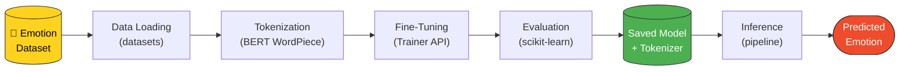
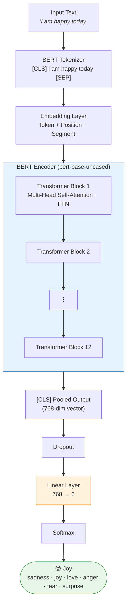
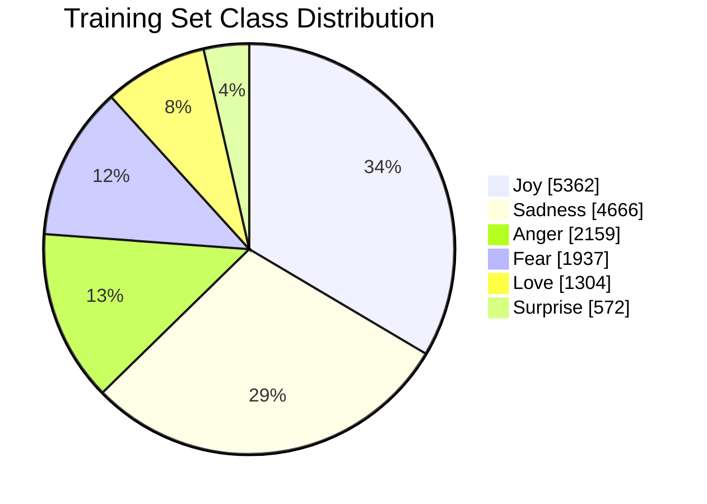
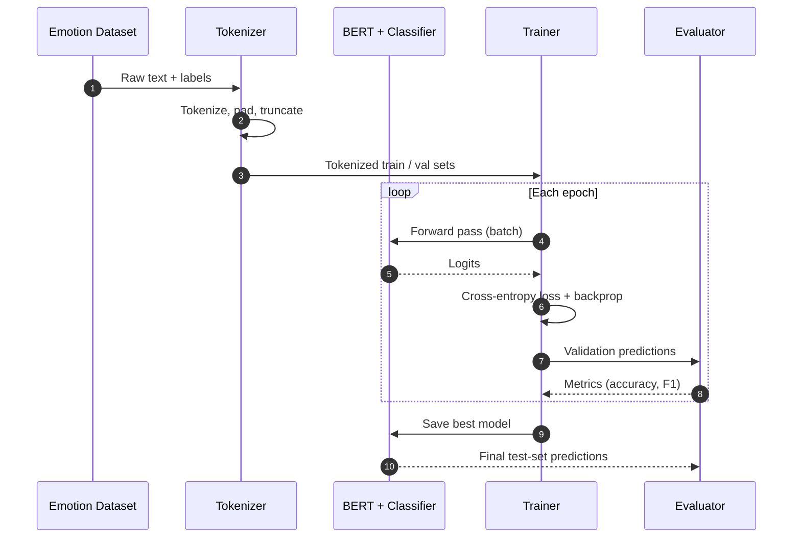
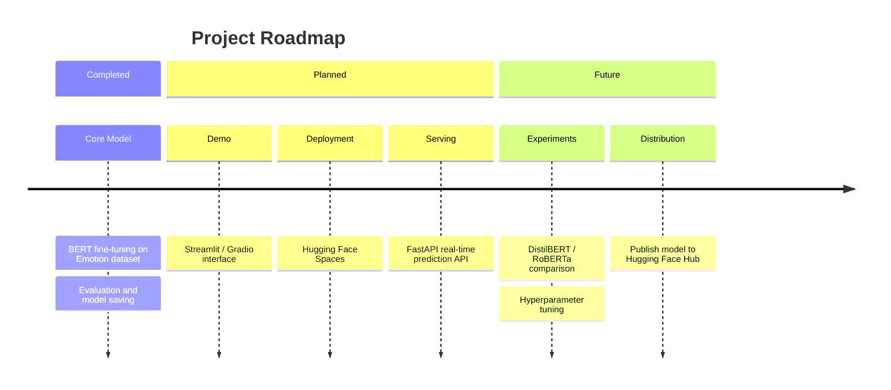

<div align="center">

# 🎭 Emotion Classification using BERT

### Fine-tuned `bert-base-uncased` for six-class emotion detection in text

Built with **Hugging Face Transformers** and **PyTorch**


[Overview](#-overview) •
[Architecture](#-model-architecture) •
[Dataset](#-dataset) •
[Quick Start](#-getting-started) •
[Results](#-results) •
[Roadmap](#-roadmap)

</div>

---

## 📑 Table of Contents

1. [Overview](#-overview)
2. [Key Features](#-key-features)
3. [System Architecture](#-system-architecture)
4. [Model Architecture](#-model-architecture)
5. [Dataset](#-dataset)
6. [Tech Stack](#-tech-stack)
7. [Training Pipeline](#-training-pipeline)
8. [Getting Started](#-getting-started)
9. [Usage & Inference](#-usage--inference)
10. [Results](#-results)
11. [Project Structure](#-project-structure)
12. [Roadmap](#-roadmap)
13. [Contributing](#-contributing)
14. [License](#-license)
15. [Author](#-author)

---

## 📌 Overview

Understanding the emotion behind text is a core task in modern NLP, with applications in customer feedback analysis, mental-health monitoring, chatbots, and social media analytics.

This project fine-tunes a pre-trained **BERT** model (`bert-base-uncased`) on the **Hugging Face Emotion dataset** to classify short English text into one of **six emotions**: *sadness, joy, love, anger, fear,* and *surprise*. Training and evaluation are handled with the Hugging Face `Trainer` API, and the final model is saved for reuse in inference.

---

## ✨ Key Features

| Feature | Description |
|---|---|
| 🧠 **Transfer Learning** | Fine-tunes a pre-trained BERT encoder instead of training from scratch |
| 🤗 **Trainer API** | Clean, reproducible training and evaluation loop |
| 🔤 **WordPiece Tokenization** | Handles out-of-vocabulary words through sub-word units |
| 📊 **Rigorous Evaluation** | Accuracy, precision, recall, F1, and confusion matrix via scikit-learn |
| 💾 **Reusable Model** | Saved model and tokenizer ready for inference |
| ☁️ **Colab-Ready** | Runs end-to-end on a free GPU runtime |

---

## 🏗 System Architecture

High-level view of how data flows from raw text to a predicted emotion.



---

## 🧠 Model Architecture

The model stacks a **classification head** on top of the 12-layer BERT encoder. The `[CLS]` token's final representation summarizes the whole sentence and is fed to the classifier.



**BERT-base specifications**

| Property | Value |
|---|---|
| Transformer layers | 12 |
| Hidden size | 768 |
| Attention heads | 12 |
| Parameters | ~110M |
| Vocabulary | 30,522 WordPiece tokens |
| Output classes | 6 |

---

## 📊 Dataset

The model is trained on the [Hugging Face Emotion dataset](https://huggingface.co/datasets/dair-ai/emotion), a collection of English Twitter messages labeled with six basic emotions.

### Label Mapping

| Label ID | Emotion | Emoji |
|:--:|---|:--:|
| 0 | Sadness | 😢 |
| 1 | Joy | 😊 |
| 2 | Love | ❤️ |
| 3 | Anger | 😠 |
| 4 | Fear | 😨 |
| 5 | Surprise | 😲 |

### Data Splits

| Split | Samples |
|---|---:|
| Train | 16,000 |
| Validation | 2,000 |
| Test | 2,000 |

### Class Distribution (Training Set)



> ⚠️ **Class imbalance:** *Joy* and *Sadness* dominate, while *Surprise* and *Love* are underrepresented. For this reason, **weighted F1** and per-class metrics are more informative than accuracy alone.

---

## 🛠 Tech Stack

| Category | Tools |
|---|---|
| **Language** | Python |
| **Deep Learning** | PyTorch |
| **NLP / Models** | Hugging Face Transformers, Datasets |
| **Evaluation** | scikit-learn |
| **Environment** | Google Colab, Jupyter Notebook |

---

## 🔄 Training Pipeline



### Step-by-Step

| # | Stage | Description |
|:--:|---|---|
| 1 | **Dataset Loading** | Load the Emotion dataset with the `datasets` library |
| 2 | **Tokenization** | Convert text to input IDs and attention masks using the `bert-base-uncased` tokenizer |
| 3 | **Model Setup** | Add a 6-class classification head to the pre-trained BERT |
| 4 | **Fine-Tuning** | Train with the Hugging Face `Trainer` using cross-entropy loss |
| 5 | **Evaluation** | Compute accuracy, precision, recall, and F1 on held-out data |
| 6 | **Model Saving** | Save model weights and tokenizer for inference |

### Training Configuration

> Update these values to match your notebook.

| Hyperparameter | Value |
|---|---|
| Base model | `bert-base-uncased` |
| Epochs | _e.g., 3_ |
| Batch size | _e.g., 16_ |
| Learning rate | _e.g., 2e-5_ |
| Optimizer | AdamW |
| Max sequence length | _e.g., 128_ |
| Hardware | Google Colab GPU |

---

## 🚀 Getting Started

### Prerequisites

- Python **3.9+**
- A GPU is recommended (Google Colab's free tier works well)

### Installation

```bash
# 1. Clone the repository
git clone https://github.com/vishal-mundewadi/Emotion-Classification-BERT.git
cd Emotion-Classification-BERT

# 2. (Optional) Create a virtual environment
python -m venv venv
source venv/bin/activate          # Windows: venv\Scripts\activate

# 3. Install dependencies
pip install -r requirements.txt
```

<details>
<summary><b>No <code>requirements.txt</code>? Install manually</b></summary>

```bash
pip install torch transformers datasets scikit-learn accelerate jupyter
```

</details>

### Run the Notebook

```bash
jupyter notebook emotion_classification_bert.ipynb
```

Or open it directly in **Google Colab** and choose **Runtime → Change runtime type → GPU**.

---

## 💡 Usage & Inference

### Inference Flow


### Code

```python
from transformers import pipeline

classifier = pipeline(
    "text-classification",
    model="./emotion_model",        # path to your saved model
    tokenizer="./emotion_model",
)

print(classifier("I am happy today"))
```

### Example Predictions

| Input | Predicted Emotion |
|---|---|
| `I am happy today` | 😊 Joy |

<details>
<summary><b>Getting <code>LABEL_0</code>, <code>LABEL_1</code>… instead of emotion names?</b></summary>

Map them using the [label table](#label-mapping) above, or set `id2label` when saving your model:

```python
id2label = {0: "sadness", 1: "joy", 2: "love", 3: "anger", 4: "fear", 5: "surprise"}
```

</details>

---

## 📈 Results

> Replace the placeholders below with your actual results from the notebook.

### Overall Performance (Test Set)

| Metric | Score |
|---|:--:|
| Accuracy | _TBD_ |
| Precision (weighted) | _TBD_ |
| Recall (weighted) | _TBD_ |
| F1-Score (weighted) | _TBD_ |

### Per-Class Performance

| Emotion | Precision | Recall | F1-Score |
|---|:--:|:--:|:--:|
| Sadness | _TBD_ | _TBD_ | _TBD_ |
| Joy | _TBD_ | _TBD_ | _TBD_ |
| Love | _TBD_ | _TBD_ | _TBD_ |
| Anger | _TBD_ | _TBD_ | _TBD_ |
| Fear | _TBD_ | _TBD_ | _TBD_ |
| Surprise | _TBD_ | _TBD_ | _TBD_ |

### Visualizations

Save your plots into an `assets/` folder and they will appear here:

```markdown


```

---

## 📁 Project Structure

```text
Emotion-Classification-BERT/
├── 📓 emotion_classification_bert.ipynb   # Training & evaluation notebook
├── 📄 requirements.txt                    # Python dependencies
├── 📖 README.md                           # Project documentation
├── 🖼 assets/                             # Plots and diagrams (optional)
└── 🤖 emotion_model/                      # Saved model & tokenizer (generated)
```

---

## 🗺 Roadmap



**Checklist**

- [x] Fine-tune BERT on the Emotion dataset
- [x] Evaluate and save the model
- [ ] Interactive demo with **Streamlit** or **Gradio**
- [ ] Web deployment (e.g., Hugging Face Spaces)
- [ ] Real-time prediction **REST API** with FastAPI
- [ ] Compare with DistilBERT and RoBERTa
- [ ] Publish the model to the Hugging Face Hub

---

## 🤝 Contributing

Contributions, issues, and feature requests are welcome.

1. **Fork** the repository
2. **Create** a feature branch: `git checkout -b feature/amazing-feature`
3. **Commit** your changes: `git commit -m "Add amazing feature"`
4. **Push** to the branch: `git push origin feature/amazing-feature`
5. **Open** a Pull Request

---

## 📄 License

Distributed under the **MIT License**. Add a `LICENSE` file to the repository to make this official.

---

## 🙏 Acknowledgements

- [BERT: Pre-training of Deep Bidirectional Transformers](https://arxiv.org/abs/1810.04805), Devlin et al.
- [CARER: Contextualized Affect Representations for Emotion Recognition](https://aclanthology.org/D18-1404/), Saravia et al., the source of the Emotion dataset
- [Hugging Face](https://huggingface.co/) for Transformers and Datasets

---

## 👤 Author

**Vishal Mundewadi**

[](https://github.com/vishal-mundewadi)

<div align="center">

⭐ If you found this project useful, please consider giving it a star! ⭐

</div>
